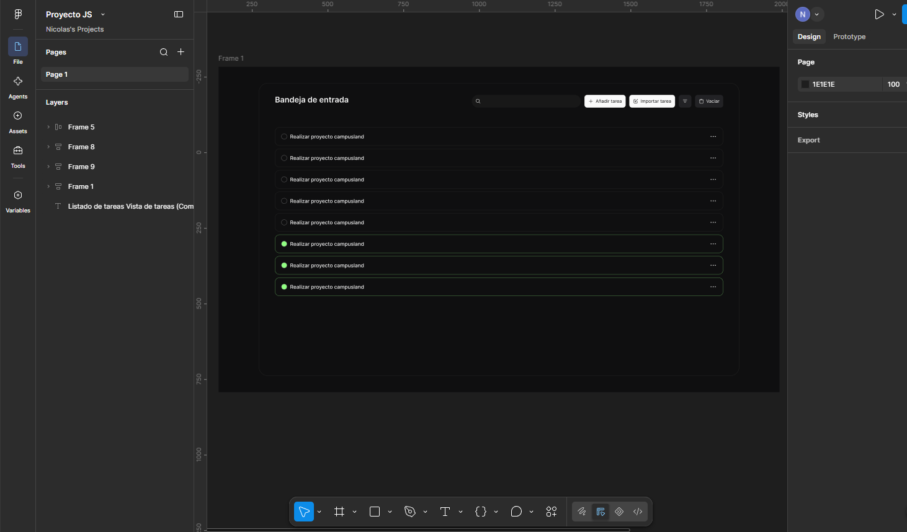
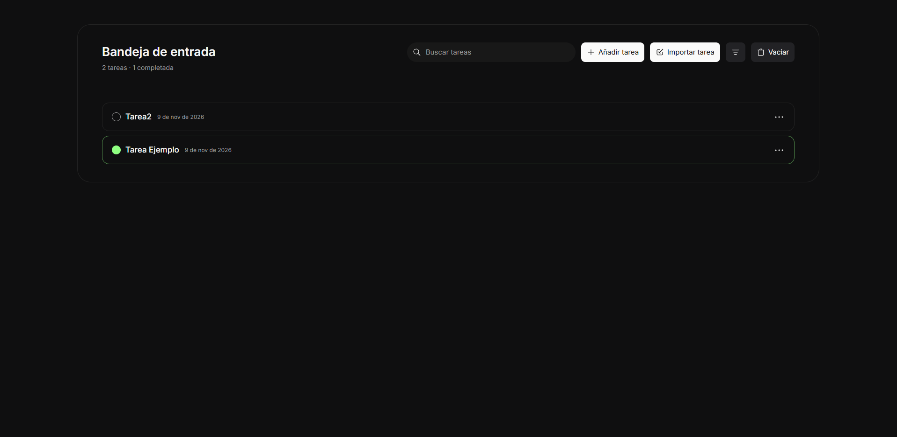

# Gestor de Tareas

Proyecto del módulo de JavaScript de Campusland, hecho por **Oliver Moreno** y **Nicolás Rodríguez**.

## Tabla de contenido

1. [Descripción](#descripción)
2. [Instrucciones de uso](#instrucciones-de-uso)
4. [Despliegue](#despliegue)
5. [Lógica implementada](#lógica-implementada)
6. [Estructura del proyecto](#estructura-del-proyecto)
7. [Diseño UX](#Diseno)
8. [Autores](#autores)

---

## Descripción

Aplicación web para gestionar una lista de tareas, hecha solo con **HTML, CSS y JavaScript** (sin librerías ni frameworks). Las tareas se guardan en el navegador, así que siguen ahí después de recargar la página.

### Qué se puede hacer

- **Crear** tareas con título, fecha de registro y estado (completada o no).
- **Actualizar** y **eliminar** tareas (eliminar pide confirmación).
- **Completar** una tarea con el círculo que tiene a la izquierda.
- **Importar** tareas desde una API pública (`jsonplaceholder.typicode.com`). Las importadas llevan la etiqueta "Importada" y no se pueden actualizar, solo eliminar.
- **Filtrar** por estado: Todas, Pendientes o Completadas.
- **Buscar** por título en tiempo real, sin distinguir mayúsculas ni tildes.
- **Vaciar** toda la lista (pide confirmación).
- Ver un **resumen** con el total de tareas y cuántas están completadas.
- Usar la app en **móvil y escritorio**, con **teclado** y con lector de pantalla.

### Tecnologías

- HTML5, CSS3 y JavaScript (módulos ES).
- **Web Components** con **Shadow DOM** para las partes dinámicas de la interfaz (tareas, modales y avisos).
- `localStorage` para guardar las tareas en formato JSON.
- `fetch` para consumir la API.
- Fuente [Inter](https://fonts.google.com/specimen/Inter) (Google Fonts).

### Diseño

La interfaz sigue el diseño hecho en Figma:
[Proyecto-JS en Figma](https://www.figma.com/design/BNPuYavlbDE0bI7jmxf3wM/Proyecto-JS?node-id=3-3&m=dev)
https://www.figma.com/design/BNPuYavlbDE0bI7jmxf3wM/Proyecto-JS?node-id=0-1&t=ZNX3MR7P02eB1TxN-1

---

## Instrucciones de uso

### Cómo abrir el proyecto

El proyecto usa módulos de JavaScript (`import` / `export`), y los navegadores **no los cargan si abres `index.html` con doble clic** (`file://`). Hay que servirlo con un servidor local. Dos opciones:

**Opción 1: Live Server (VS Code)**

1. Instala la extensión *Live Server*.
2. Clic derecho sobre `index.html` → **Open with Live Server**.

**Opción 2: Python**

```bash
python -m http.server 5500
```

Luego abre `http://localhost:5500` en el navegador.

> Para que se vea la fuente Inter y funcione la importación de tareas se necesita conexión a internet. Sin conexión, la app funciona igual, pero con la fuente del sistema y sin poder importar.

### Cómo usar la aplicación

| Qué quieres hacer | Cómo |
|---|---|
| Crear una tarea | Botón **Añadir tarea**. Escribe el título (obligatorio), elige la fecha (por defecto hoy) y pulsa **Guardar** o Enter. |
| Completar o reabrir una tarea | Clic en el **círculo** de la izquierda. Al completarse se pone verde. |
| Actualizar una tarea | Botón de **tres puntos** de la tarea → **Actualizar**. La fecha de registro no se puede cambiar. |
| Eliminar una tarea | Botón de **tres puntos** → **Eliminar** → confirmar. |
| Importar tareas | Botón **Importar tarea**. Marca una o varias (o **Seleccionar todo**) y pulsa **Importar seleccionadas**. Si falla la conexión, aparece **Reintentar**. |
| Filtrar por estado | Botón de **filtro** (icono de líneas) → Todas, Pendientes o Completadas. |
| Buscar | Escribe en el buscador. Funciona junto con el filtro de estado. |
| Vaciar la lista | Botón **Vaciar** → confirmar. |

Cada acción importante muestra un aviso breve (por ejemplo "Tarea creada"). Si el navegador no deja guardar los datos (almacenamiento lleno o desactivado), el aviso es rojo y no se guarda nada.

### Teclado

- **Tab / Shift + Tab:** moverse entre botones y campos.
- **Enter o Espacio:** activar botones y el círculo de completar.
- **Enter** en el campo de título: guarda la tarea.
- **Esc:** cierra menús y modales.
- Dentro de un modal el foco queda atrapado, y al cerrarlo vuelve al botón que lo abrió.

---


## Lógica implementada

### Modelo de datos

Cada tarea es un objeto JSON con esta forma:

```json
{
  "id": "task-mh4k7q2z-9f3a",
  "title": "Realizar proyecto campusland",
  "createdAt": "2026-11-08T15:30:00.000Z",
  "completed": false,
  "imported": false
}
```

| Campo | Tipo | Descripción |
|---|---|---|
| `id` | string | Identificador único (ver estándar abajo). |
| `title` | string | Descripción de la tarea, sin espacios sobrantes. |
| `createdAt` | string | Fecha de registro en formato ISO 8601. |
| `completed` | boolean | `true` si la tarea está terminada. |
| `imported` | boolean | `true` si viene de la API. Las importadas no se pueden actualizar. |

### Estándar de identificadores

Formato: `task-` + marca de tiempo en base 36 + `-` + sufijo aleatorio de 4 caracteres en base 36.

```
task-mh4k7q2z-9f3a
```

- El prefijo `task-` indica qué tipo de dato es.
- La marca de tiempo (`Date.now()`) hace que los ids sean únicos en el tiempo.
- El sufijo aleatorio evita choques si dos ids se crean en el mismo milisegundo.

Lo genera `generateId()` en `js/utils/id-generator.js`. Las tareas importadas también reciben un id con este formato (no se usa el `id` que trae la API).

### Componentes

La estructura fija de la pantalla está en `index.html`. Las partes dinámicas son Web Components, y todos usan su propio Shadow DOM, salvo `<task-app>`, que solo conecta la pantalla y no dibuja nada:

| Componente | Archivo | Qué hace |
|---|---|---|
| `<task-app>` | `task-app.js` | Orquestador. Envuelve la pantalla que está en `index.html`: carga las tareas, conecta los botones, el buscador y el filtro, escucha los eventos de los demás componentes, llama a los servicios y vuelve a dibujar. No dibuja HTML propio. |
| `<task-list>` | `task-list.js` | Dibuja varios `<task-item>` y muestra "No hay tareas" o "Sin resultados" si la lista está vacía. |
| `<task-item>` | `task-item.js` | Una tarea: círculo de estado, título, fecha, etiqueta "Importada" y menú de tres puntos (Actualizar y Eliminar). |
| `<task-form-modal>` | `task-form-modal.js` | Modal para crear o editar una tarea, con validación del título. |
| `<import-modal>` | `import-modal.js` | Modal que pide las tareas a la API y deja elegir cuáles importar. |
| `<confirm-dialog>` | `confirm-dialog.js` | Modal de confirmación reutilizable (eliminar y vaciar). |
| `<toast-message>` | `toast-message.js` | Avisos breves de éxito o error. |

**Cómo se usan:**

| Componente | Propiedades y métodos |
|---|---|
| `<task-list>` | `list.tasks = [...]` (tareas a mostrar) · `list.filtered = true/false` (si hay filtro o búsqueda activos, para elegir el mensaje de lista vacía) |
| `<task-item>` | `item.task = {...}` |
| `<task-form-modal>` | `modal.open()` (crear) · `modal.open({ task })` (editar) · `modal.close()` |
| `<import-modal>` | `modal.open()` · `modal.close()` |
| `<confirm-dialog>` | `const ok = await dialog.open({ title, message, confirmText })` → `true` si acepta, `false` si cancela |
| `<toast-message>` | `toast.show("Mensaje")` · `toast.show("Mensaje", "error")` |

### Eventos

Los componentes se comunican hacia arriba con eventos personalizados (`CustomEvent`) que llevan `bubbles: true` y `composed: true`, para que atraviesen el Shadow DOM.

| Evento | Lo emite | `detail` | Qué hace `<task-app>` al recibirlo |
|---|---|---|---|
| `task-toggle` | `<task-item>` | `{ id }` | `toggleTask(id)` |
| `task-edit` | `<task-item>` | `{ id }` | Abre el formulario en modo editar |
| `task-delete` | `<task-item>` | `{ id }` | Pide confirmación y llama a `deleteTask(id)` |
| `task-save` | `<task-form-modal>` | `{ id?, title, createdAt, completed }` | Con `id`: `updateTask`. Sin `id`: `addTask` |
| `tasks-import` | `<import-modal>` | `{ tasks: [...] }` | `addImportedTasks(tasks)` |

### Servicios

**`js/services/task-service.js`**: operaciones sobre las tareas. Cada una lee del `localStorage`, hace el cambio y guarda. Si no se puede guardar, devuelven `null` (o `false` en `deleteTask`).

| Función | Qué hace | Devuelve |
|---|---|---|
| `addTask({ title, completed?, createdAt? })` | Crea una tarea (con `imported: false`). Rechaza títulos vacíos. | La tarea, o `null` |
| `updateTask(id, { title?, completed? })` | Actualiza una tarea. **Rechaza las importadas** y los títulos vacíos. | La tarea, o `null` |
| `deleteTask(id)` | Elimina una tarea. | `true` / `false` |
| `toggleTask(id)` | Cambia pendiente ↔ completada. | La tarea, o `null` |
| `completeAll()` | Marca todas como completadas. | La lista, o `null` |
| `clearAll()` | Vacía la lista. | `[]`, o `null` |
| `addImportedTasks(tasks)` | Agrega tareas importadas, **sin duplicar** las que ya existen (compara el título sin distinguir mayúsculas). | Las tareas agregadas, o `null` |

**`js/services/storage-service.js`**: `getTasks()` y `saveTasks(tasks)`.

**`js/services/api-service.js`**: `fetchTodos()`, ver más abajo.

### Persistencia

- Las tareas se guardan como una lista JSON en `localStorage`, bajo la clave `tasks`.
- `getTasks()` está protegida con `try/catch`: si el JSON está corrupto, no es una lista, o trae elementos dañados (sin `id` o `title` de tipo texto), devuelve solo lo válido o `[]`, y la app no se rompe.
- `saveTasks()` también usa `try/catch` y devuelve `false` si el almacenamiento está lleno o desactivado. Entonces la app muestra un aviso de error en lugar del de éxito.

### Integración con la API

`fetchTodos()` consulta `https://jsonplaceholder.typicode.com/todos?_limit=25`:

1. Limita el resultado a **25 tareas**.
2. Revisa los errores: falla de red (`try/catch`), respuesta no exitosa (`response.ok`) y JSON inválido. Cada uno lanza un mensaje legible en español.
3. Convierte cada elemento de la API al modelo propio: nuevo `id` con el estándar de la app, `title` limpio, `completed`, `createdAt` con la fecha de importación e `imported: true`.

El modal de importación muestra un indicador de carga mientras espera y, si hay un error, un mensaje con el botón **Reintentar**.

### Seguridad

Los textos del usuario y de la API se insertan siempre con `textContent` o `.value`, nunca como HTML. Así, un título como `` se muestra como texto y no se ejecuta.

### Accesibilidad y responsive

- Todos los campos tienen `label` o `aria-label`; los menús usan `role="menu"` y `aria-expanded`.
- Contador, avisos y lista vacía usan `aria-live` o `role="status"`.
- Foco visible en todos los controles; contraste de colores por encima de 4.5:1.
- Diseño **mobile-first**: en móvil el buscador ocupa una línea y los botones se acomodan debajo; desde 768px la barra pasa a una sola fila, como en el diseño.


## Estructura del proyecto

```
├── index.html               Estructura fija: título, buscador, botones, filtro y los componentes
├── css/
│   ├── variables.css        Colores, tipografía, espaciado y radios
│   ├── base.css             Reset y estilos globales
│   └── app.css              Estilos de la pantalla principal (barra, botones, filtro)
├── js/
│   ├── main.js              Punto de entrada
│   ├── components/          Web Components (ver tabla de componentes)
│   ├── services/            task-service, storage-service, api-service
│   └── utils/
│       └── id-generator.js  generateId() y documentación del modelo
├── public/                  Iconos SVG
└── docs/                    Enunciado, wireframes y capturas
```

## Diseno
La interfaz sigue el diseño hecho en Figma:
[Proyecto-JS en Figma](https://www.figma.com/design/BNPuYavlbDE0bI7jmxf3wM/Proyecto-JS?node-id=0-1&t=ZNX3MR7P02eB1TxN-1)



---

## Autores

- **Oliver Moreno**: base del proyecto, modelo de datos, servicios y componentes de presentación (`task-item`, `task-list`, `import-modal`).
- **Nicolás Rodríguez**: formulario, orquestador `task-app`, filtros, buscador, confirmaciones, accesibilidad, responsive y documentación.
